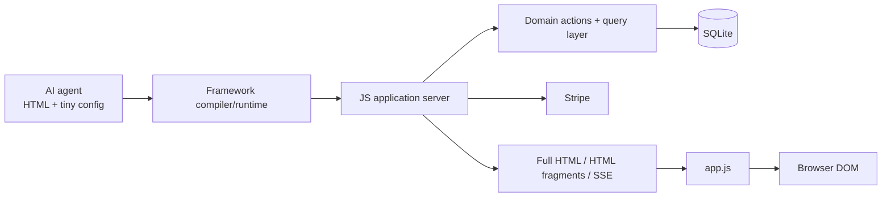
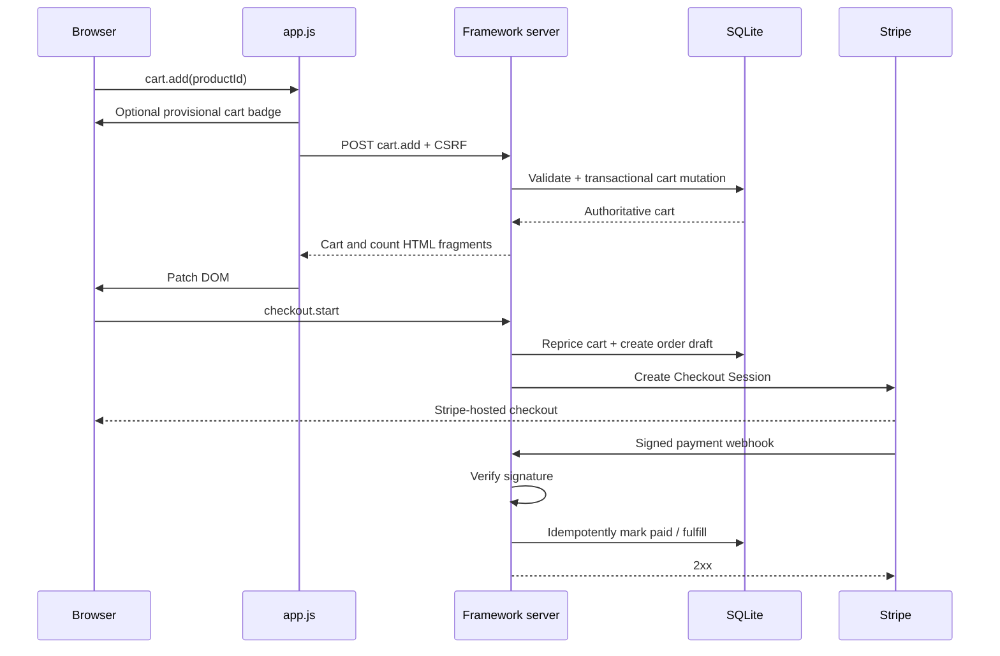
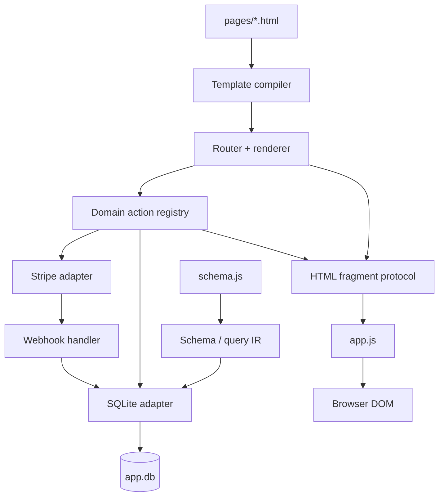

# Designing an Agent-Optimized Minimal Full-Stack Ecommerce Framework

## Executive summary

The viable architecture is not "HTML, CSS, JavaScript, and SQLite with no backend." A production ecommerce application needs a trusted server boundary for prices, inventory, sessions, orders, payment secrets, and fulfillment. The stronger goal is:

> **The backend exists, but the AI agent almost never has to author backend code.**

The framework should expose a deliberately tiny domain-specific surface to the agent and absorb routing, SQL, validation, security, rendering, reactivity, payments, responsive layout, caching, and deployment conventions internally.

The architecture should therefore be:



This is technically conservative. htmx already demonstrates that links and forms can be enhanced into asynchronous requests whose responses are HTML rather than JSON, while retaining ordinary HTML navigation semantics. Datastar takes the same idea further with declarative `data-*` behavior and server-sent HTML patches over SSE. Pico demonstrates how much CSS authoring can disappear when semantic HTML is styled directly. citeturn9view6turn9view5turn9view7

The key design decision is **not** to expose htmx, Datastar, Tailwind, SQL, ORM details, routing, React-like state management, or arbitrary client expressions to the agent. Those are implementation techniques for the framework, not abstractions the application author should have to reason about.

The target application surface should look approximately like this:

```html
<link rel="stylesheet" href="/_app/app.css">
<script type="module" src="/_app/app.js"></script>

<x-list of="Product" as="p" page="24">
  <article>
    <a href="/products/{{p.slug}}">
      
      <h2>{{p.name}}</h2>
      <x-money value="{{p.price}}"></x-money>
    </a>

    <button data-action="cart.add({{p.id}})">
      Add to cart
    </button>
  </article>
</x-list>

<x-pager></x-pager>
```

The server consumes the custom elements. The browser should normally receive ordinary semantic HTML plus a few `data-*` attributes understood by the small runtime.

The strongest initial database choice is **SQLite**, provided deployment is intentionally single-writer and single-host. SQLite supports concurrent readers while WAL is active, but still permits only one writer at a time, and WAL databases must remain on the same host rather than a network filesystem. Those limitations should determine the PostgreSQL migration trigger rather than premature assumptions about catalog size. citeturn9view0turn12search1turn12search9

For payments, the first implementation should use **Stripe Checkout Sessions with Stripe-hosted Checkout**, not custom card handling. Stripe recommends Checkout Sessions with its higher-level payment UI for most integrations, while its security guidance explains that payment details can be sent directly to Stripe rather than through the merchant server, reducing PCI burden. Payment completion must nevertheless be driven by verified webhooks, not by the customer's return page. citeturn3search4turn9view4turn10search2turn10search0

The economic proposition is therefore not "a smaller Next.js." It is:

> **A constrained ecommerce operating system whose API happens to be HTML.**

That constraint is what could make it substantially better for coding agents. Next.js intentionally supports a wide range of application architectures, while this framework can pre-decide nearly everything that is repetitive in ecommerce. Next.js itself abstracts bundlers and compilers but still exposes React, server/client boundaries, routing conventions, data mutation mechanisms, and application composition. Vercel's own Commerce starter shows how much domain-specific infrastructure is needed to make ecommerce concise on top of that general-purpose stack. citeturn7search28turn7search2

A reasonable falsification criterion is stringent: for a canonical store flow, the proposed framework should require **at least 3x less agent-authored LOC, at least 50% fewer files touched, and at least 50% fewer generated tokens**, while passing the same functional and security acceptance suite. If it cannot, there is little reason to create another framework.

## Agent-facing surface

### Design principle: expose business intent, not implementation mechanism

The agent should ideally know only five concepts:

| Concept | Meaning |
|---|---|
| Resource | Data being displayed, such as `Product` or `Order` |
| Action | Business mutation, such as `cart.add` |
| Fragment | Independently replaceable server-rendered region |
| Form | Validated structured input |
| Layout hint | Rare explicit visual intent that semantic HTML cannot infer |

Everything else should be framework-owned.

That means no public distinction between "server component" and "client component", no REST-versus-RPC decision, no query-cache library, no CSS utilities, no router API for normal pages, no direct SQL, no client global store, and no manual loading-state plumbing.

The DSL should also remain **closed rather than programmable**. An arbitrary expression language such as:

```html
<div x-if="cart.total > 40 && user.region !== 'EU'">
```

looks convenient but rapidly creates a second programming language, additional injection concerns, difficult static analysis, and a larger decision surface for agents. The first version should support interpolation, conditionals, loops, resources, and domain actions, but not general client-side computation.

### Imports and theme

Every normal page should require only these imports:

```html
<link rel="stylesheet" href="/_app/app.css">
<script type="module" src="/_app/app.js"></script>
```

There should be no npm imports in application HTML and no per-component JavaScript.

The application's CSS should normally be limited to variables:

```css
:root {
  --brand: oklch(58% 0.19 260);
  --radius: .75rem;
  --density: 1;
  --content-width: 72rem;
}
```

Pico's classless mode demonstrates the useful base case: semantic elements such as headings, forms, buttons, tables, and structural containers can receive coherent default styling without application-specific classes. citeturn9view7turn0search6

However, **fully automatic layout inference is not possible in the general case**. The same `<section>` containing four children could legitimately mean a grid, vertical stack, horizontally scrollable rail, comparison table, or asymmetric editorial layout. Trying to infer all of that would make framework behavior magical and unpredictable.

The better compromise is semantic styling plus a tiny layout vocabulary:

```html
<section data-layout="grid">
<section data-layout="split">
<section data-layout="row">
<section data-layout="sidebar">
```

Responsive behavior, spacing, breakpoints, wrapping, card sizing, focus treatment, reduced-motion handling, form sizing, and accessible defaults remain internal.

### Product listing

```html
<x-list
  name="products"
  of="Product"
  as="p"
  page="24"
  sort="newest"
>
  <article>
    <a href="/products/{{p.slug}}">
      
      <h2>{{p.name}}</h2>
      <x-money value="{{p.price}}"></x-money>
    </a>

    <button data-action="cart.add({{p.id}})">
      Add to cart
    </button>
  </article>
</x-list>

<x-pager for="products"></x-pager>
```

The agent does not write a fetch call, endpoint, serializer, loading component, result loop in JavaScript, React key, cache invalidation rule, or SQL query.

`{{...}}` interpolation is HTML-escaped by default. Rendering trusted raw HTML should require a visibly different construct and should be uncommon.

### Product detail

A filesystem route can provide route binding automatically:

```text
pages/products/[slug].html
```

```html
<x-record of="Product" by="slug" as="p">
  <main data-layout="split">
    

    <section>
      <h1>{{p.name}}</h1>
      <x-money value="{{p.price}}"></x-money>
      <p>{{p.description}}</p>

      <button data-action="cart.add({{p.id}})">
        Add to cart
      </button>
    </section>
  </main>
</x-record>
```

`by="slug"` binds the `[slug]` route segment without requiring route-handler code.

### Cart

The minimum version should be highly opinionated:

```html
<aside data-fragment="cart">
  <x-cart editable></x-cart>
</aside>
```

That can compile into semantic HTML containing line items, quantity controls, remove buttons, subtotal, accessibility labels, empty-cart state, and canonical actions.

For greater customization later, slots can be introduced without expanding the normal surface:

```html
<x-cart as="line">
  <template slot="item">
    
    <strong>{{line.product.name}}</strong>
    <x-money value="{{line.total}}"></x-money>
  </template>
</x-cart>
```

The framework should resist exposing customization until real applications prove it necessary.

### Checkout

The highest-SNR API is intentionally tiny:

```html
<x-checkout>Checkout</x-checkout>
```

The payment provider belongs in configuration, not page markup:

```js
export default {
  payments: "stripe"
}
```

Clicking checkout means one specific domain operation:

1. Load the authoritative server cart.
2. Re-fetch current product prices and availability.
3. Apply authoritative discount, tax, and shipping rules.
4. Create an order draft transactionally.
5. Create the Stripe Checkout Session on the server.
6. Redirect the browser to Stripe.
7. Await the signed webhook.
8. Idempotently mark the order paid and trigger fulfillment.

The page cannot submit its own amount or payment status.

### Authentication

Default login can be one element:

```html
<x-auth mode="login"></x-auth>
```

Registration:

```html
<x-auth mode="register"></x-auth>
```

Account state:

```html
<x-auth mode="account"></x-auth>
```

For customized screens, the low-level escape hatch remains ordinary HTML:

```html
<form data-action="auth.login">
  <label>
    Email
    <input
      type="email"
      name="email"
      autocomplete="email"
      required
    >
  </label>

  <label>
    Password
    <input
      type="password"
      name="password"
      autocomplete="current-password"
      required
    >
  </label>

  <x-errors></x-errors>
  <button>Sign in</button>
</form>
```

The action name identifies a framework-provided server operation. It does not identify an arbitrary URL the agent must implement.

### Search, filters, and pagination

These should all use normal query-string semantics so pages work without the enhancement runtime:

```html
<form method="get" data-live="300">
  <input
    type="search"
    name="q"
    placeholder="Search products"
  >

  <select name="category">
    <option value="">All categories</option>
    <option value="shoes">Shoes</option>
    <option value="shirts">Shirts</option>
  </select>

  <select name="sort">
    <option value="newest">Newest</option>
    <option value="price-asc">Price: low to high</option>
    <option value="price-desc">Price: high to low</option>
  </select>
</form>

<x-list
  name="products"
  of="Product"
  as="p"
  search="q:name,description"
  filter="category"
  sort="sort"
  page="24"
>
  <article>
    <h2>{{p.name}}</h2>
    <x-money value="{{p.price}}"></x-money>
  </article>
</x-list>

<x-pager for="products"></x-pager>
```

`data-live="300"` means: when inputs change, debounce for 300 ms, issue the equivalent GET, update the relevant server-rendered fragment, and update history/query parameters.

Without JavaScript, the form can still be submitted normally. That progressive-enhancement property follows the same basic architecture htmx uses for boosted links and forms. citeturn9view6

Pagination should be cursor-based internally where possible, even if the public component merely says `page="24"`. The agent should not choose offset versus cursor pagination unless it is handling an exceptional query.

### General forms

```html
<form data-action="profile.update">
  <label>
    Name
    <input name="name" required maxlength="80">
  </label>

  <label>
    Email
    <input type="email" name="email" required>
  </label>

  <x-errors></x-errors>

  <button>Save</button>
</form>
```

The browser's native constraints provide immediate UX, while the action's server schema performs independent authoritative validation. OWASP recommends allow-list validation and strong validation of structured data; browser validation alone cannot be trusted because the client is controlled by the requester. citeturn4search1

A useful v1 vocabulary is therefore remarkably small:

| Surface | Purpose |
|---|---|
| `<x-list>` | Query and repeat a collection |
| `<x-record>` | Load one route-bound resource |
| `<x-money>` | Canonical monetary formatting |
| `<x-pager>` | Pagination |
| `<x-cart>` | Canonical cart UI |
| `<x-checkout>` | Checkout initiation |
| `<x-auth>` | Authentication/account UI |
| `<x-errors>` | Server validation errors |
| `data-action` | Invoke a named domain mutation |
| `data-fragment` | Address a patchable HTML region |
| `data-live` | Debounced GET enhancement |
| `data-layout` | Minimal explicit layout intent |
| `data-pending` | Optional loading-state override |
| `data-stream` | Opt into a named SSE channel |

The discipline matters more than the syntax. Every new public primitive increases the language model's search space.

## Runtime architecture

### Client runtime

`app.js` should be small from the application's perspective, though its internal implementation can be substantial. Its job is not to recreate React. Its job is to make server-rendered HTML feel modern.

The underlying pattern is already well established. htmx can intercept ordinary links and forms, issue requests, and swap returned HTML. It supports targeted fragment selection and out-of-band updates. Datastar similarly uses declarative attributes and can morph server-returned elements identified by IDs, including multiple patches over an SSE response. citeturn9view6turn6search0turn9view5turn6search2

The runtime should own the following behavior:

| Responsibility | Framework behavior |
|---|---|
| Navigation | Intercept eligible same-origin GET navigation, fetch, patch main region, update History API |
| Partial updates | Patch named `data-fragment` regions rather than reconstructing state client-side |
| Focus | Preserve or intelligently restore focus across patches |
| Scroll | Restore history scroll position and handle anchor navigation |
| Forms | Enhance standard forms while preserving normal submission fallback |
| Actions | Convert `data-action` into authenticated server mutation requests |
| Loading | Set `aria-busy`, disable duplicate submission, show canonical pending state |
| Validation | Mirror basic constraints client-side; display authoritative server errors |
| Toasts | Consume server-returned toast metadata |
| Prefetching | Prefetch safe GET navigation only |
| Optimistic UI | Apply only framework-approved reversible mutations |
| Transitions | Use the View Transition API where supported |
| SSE | Maintain opt-in server-event channels for genuinely live state |
| Recovery | Roll back optimistic state or perform authoritative refetch after failure |

The browser platform now provides a View Transition API for transitions between DOM states and documents, which means the framework can progressively enhance transitions rather than shipping a large animation system. citeturn11search0turn11search2

SSE is also native browser infrastructure. `EventSource` receives one-way server events using `text/event-stream`, which fits order status, stock notices, administrative dashboards, and similar server-to-browser updates without introducing a WebSocket protocol for every application. citeturn11search1turn11search3

**Optimistic UI must be constrained.** It is safe to optimistically increment a visible cart badge and then reconcile it. It is not safe to optimistically establish price, discount eligibility, inventory ownership, payment status, or order fulfillment. Those are server facts.

Likewise, prefetching should be restricted to GET requests. A hover must never trigger a mutation.

### Server runtime

The server is where most framework complexity belongs.

A filesystem convention can eliminate ordinary route configuration:

```text
pages/index.html                    /
pages/products/index.html           /products
pages/products/[slug].html          /products/:slug
pages/cart.html                     /cart
pages/account.html                  /account
pages/orders/[id].html              /orders/:id
```

For each request, the server:

1. Resolves the route.
2. Loads route/query parameters.
3. Executes resource bindings such as `<x-list>` and `<x-record>`.
4. Renders custom framework elements into standard HTML.
5. Returns either a complete document or the requested fragment set.
6. Handles domain actions separately from rendering.
7. Performs session, authorization, CSRF, validation, and transaction logic.
8. Handles Stripe API calls and webhook events.
9. Owns caching, logging, observability, and security headers.

The server can distinguish enhanced requests with an internal header such as:

```http
X-App-Request: fragment
```

A normal browser request receives:

```html
<!doctype html>
<html>
  ...
  <main data-fragment="page">
    ...
  </main>
</html>
```

An enhanced request can return only:

```html
<main data-fragment="page">
  ...
</main>
```

A mutation can return multiple independent fragments:

```html
<aside data-fragment="cart">
  <!-- authoritative cart HTML -->
</aside>

<span data-fragment="cart-count">
  3
</span>

<template data-toast="success">
  Added to cart
</template>
```

`app.js` identifies each fragment and morphs or replaces the existing region.

This is conceptually similar to htmx out-of-band swaps and Datastar's element patching, but a framework-specific protocol can be smaller because it only has to support the chosen application model. citeturn6search0turn9view5

Validation failure should simply be another HTML response:

```http
422 Unprocessable Content
```

```html
<form data-fragment="profile-form" data-action="profile.update">
  <label>
    Email
    <input
      type="email"
      name="email"
      value="not-an-email"
      aria-invalid="true"
    >
  </label>

  <p role="alert">Enter a valid email address.</p>
  <button>Save</button>
</form>
```

There is no need to send JSON errors, deserialize them, mutate a client form-state store, and separately render the errors.

### Domain state should remain server state

A major simplification is to avoid a general-purpose client state store.

The system should separate:

**Authoritative state:** cart contents, inventory, account data, prices, orders, payment state. Stored server-side.

**URL state:** query, category, sort, page/cursor. Stored in the URL.

**Ephemeral UI state:** open dialog, focus, pending animation. Stored in the DOM/runtime.

This eliminates a large class of synchronization problems created when the browser duplicates server state.

### Typical cart-to-payment flow



Stripe explicitly recommends webhook-based fulfillment for reliable checkout processing because customers may never reach the success page. Stripe also warns that fulfillment can be invoked repeatedly or concurrently, requiring idempotent handling. citeturn10search2

## Data layer

### Why SQLite is the right default

For this framework's first implementation, SQLite is probably a better choice than a client/server database because it minimizes infrastructure without weakening the relational model ecommerce needs.

SQLite itself explicitly documents the architecture where an application server receives high-level requests and performs SQLite operations internally. The database does not need to be exposed directly to browsers for SQLite to remain useful. citeturn9view1

The important properties are:

| Database | Operational surface | Concurrency model | Agent-visible complexity | Fit |
|---|---|---|---|---|
| **SQLite** | Embedded file | Many readers, one writer | Very low | **Best v1 default** |
| PostgreSQL | Separate DB server/service | MVCC, strong concurrent workload support | Medium | Best scale-out adapter |
| MySQL/InnoDB | Separate DB server/service | MVCC plus row-level locking | Medium | Viable, little unique v1 advantage |
| MongoDB | Separate document database | Document-oriented | Medium | Poorer fit for this relational domain abstraction |
| IndexedDB | Browser-origin database | Client/local | Low infrastructure, high authority problem | Cache/offline only |
| sql.js | SQLite in WASM/browser | Client/local | Low setup | Prototype/local state only |

SQLite WAL mode allows readers and writers to proceed concurrently in ways rollback mode does not, but SQLite still serializes writers. WAL also relies on shared memory between processes on the same machine and therefore is not suitable for a database file on a network filesystem. citeturn9view0turn12search1turn12search9

PostgreSQL's MVCC architecture is specifically designed so reads and writes can proceed with substantially less contention between concurrent sessions. That makes PostgreSQL the natural second adapter once application topology demands multiple application replicas, high concurrent write throughput, or managed database high availability. citeturn1search6turn1search34

MySQL's InnoDB engine likewise provides ACID transactions, MVCC, consistent reads, and row-level locking. It is technically suitable, but for a new framework there is no obvious agent-DX advantage in making it the primary scale-out target rather than PostgreSQL. That preference is an architectural judgment, not a capability deficiency in MySQL. citeturn2search6turn2search16

MongoDB deliberately provides a flexible document model and recommends organizing data according to access patterns, including embedding data that is accessed together. That can be valuable, but products, variants, carts, users, orders, inventory movements, payments, and uniqueness constraints map naturally to the relational transaction model the framework wants to standardize. Choosing MongoDB would therefore increase abstraction work without solving a v1 problem. citeturn1search3

IndexedDB is an origin-scoped transactional browser database. It is useful for local caches or offline drafts, but browser-owned data cannot be the authoritative database for a multi-user ecommerce service. citeturn2search1

Similarly, sql.js runs SQLite compiled to WebAssembly and can create a browser-side SQLite database, but its default database lives in browser memory and must be explicitly exported for persistence. Its own documentation distinguishes this use from native server-side bindings. It is useful technology, but it does not remove the ecommerce trust boundary. citeturn2search2

### Hide SQLite from the agent

The public application abstraction should not be:

```js
db.prepare("SELECT ...")
```

or even:

```js
sql`
  SELECT *
  FROM products
`
```

The normal read interface should describe intent:

```js
Product.find({
  slug
})
```

```js
Product.list({
  where: {
    active: true,
    categoryId
  },
  search: q,
  order: [
    "createdAt desc",
    "id desc"
  ],
  limit: 24,
  after
})
```

The normal mutation API should be **domain-specific**, not generic CRUD:

```js
Cart.add({
  session,
  productId,
  quantity: 1
})
```

```js
Cart.setQuantity({
  session,
  productId,
  quantity: 3
})
```

```js
Checkout.start({
  session
})
```

This distinction matters. A generic API such as:

```js
Product.update(id, {
  stock: stock - 1
})
```

makes it easy for an agent to bypass inventory rules, transaction boundaries, authorization, and audit behavior.

### Generated SQL

A resource query such as:

```js
Product.list({
  where: {
    active: true,
    categoryId
  },
  order: ["createdAt desc", "id desc"],
  limit: 24,
  after: cursor
})
```

might lower to:

```sql
SELECT
  id,
  slug,
  name,
  image,
  price_minor,
  currency,
  created_at
FROM products
WHERE active = ?
  AND (? IS NULL OR category_id = ?)
  AND (
    ? IS NULL
    OR (created_at, id) < (?, ?)
  )
ORDER BY created_at DESC, id DESC
LIMIT ?;
```

All dynamic values are bound parameters. OWASP identifies prepared statements and parameterized queries as a primary SQL-injection defense and warns against constructing SQL by concatenating untrusted input. citeturn4search10

A cart mutation might internally become:

```sql
BEGIN IMMEDIATE;

INSERT INTO cart_lines (
  cart_id,
  product_id,
  quantity
)
VALUES (?, ?, ?)
ON CONFLICT (cart_id, product_id)
DO UPDATE SET
  quantity = cart_lines.quantity + excluded.quantity;

SELECT
  product_id,
  quantity
FROM cart_lines
WHERE cart_id = ?;

COMMIT;
```

The framework can use `BEGIN IMMEDIATE` deliberately when a mutation must establish its write transaction early. SQLite documents that only one write transaction can exist simultaneously and that `BEGIN IMMEDIATE` starts that write transaction immediately, potentially returning `SQLITE_BUSY` if another writer already holds it. citeturn12search9

The framework should therefore own busy retries, transaction boundaries, and conflict behavior. The AI should not have to learn SQLite lock mechanics.

### Search

The public abstraction should remain:

```html
<x-list
  of="Product"
  search="q:name,description"
>
```

The SQLite adapter can lower this to FTS5 when appropriate. SQLite ships full-text-search functionality through FTS5. A future PostgreSQL adapter can implement the same high-level search capability with PostgreSQL's own indexing/search machinery. citeturn1search17

The DSL must not expose SQLite-specific FTS syntax because that would destroy adapter portability.

### Schema and migration strategy

The key architectural mistake would be making handwritten `schema.sql` the only source of truth if PostgreSQL support is expected later.

Instead use a small canonical schema intermediate representation:

```js
export default schema({
  Product: model({
    id: id(),
    slug: text().unique(),
    name: text(),
    description: text().optional(),
    image: text().optional(),
    price: money(),
    active: bool().default(true),
    categoryId: relation("Category").optional(),
    createdAt: timestamp()
  }),

  Order: model({
    id: id(),
    userId: relation("User").optional(),
    status: enumOf(
      "draft",
      "pending_payment",
      "paid",
      "fulfilled",
      "cancelled"
    ),
    total: money(),
    createdAt: timestamp()
  })
})
```

From that IR the SQLite adapter generates:

```text
schema.js
   ↓
migration planner
   ↓
migrations/*.sql
   ↓
schema.sql
```

`schema.sql` remains present and inspectable, but should normally be generated rather than hand-maintained.

The adapter contract should operate on:

```text
schema IR
query AST
transaction API
capabilities
```

not arbitrary SQL strings.

A capability interface can explicitly represent differences:

```js
adapter.capabilities = {
  transactions: true,
  fullTextSearch: true,
  returning: true,
  json: true
}
```

This is preferable to pretending all relational databases behave identically.

One current implementation detail deserves caution: Node's built-in `node:sqlite` API is still documented as release-candidate stability in current Node documentation, so the framework's public contract should not depend on that specific API. The adapter boundary makes it possible to use a mature native SQLite binding today and change the internal driver later without affecting agent code. citeturn9view2

### When SQLite stops being the right database

Do not migrate because the database file becomes "large" in the abstract. Migrate when the operating model conflicts with SQLite's architecture.

The concrete triggers are:

| Trigger | Consequence |
|---|---|
| Multiple application machines need direct write access | Move to PostgreSQL |
| Deployment filesystem is ephemeral | Move to managed PostgreSQL or redesign persistence |
| Database needs to live on a separate network host | Move to PostgreSQL |
| Sustained writer contention becomes material | Benchmark, then migrate if contention is structural |
| Active-active/multi-region writes are required | SQLite is the wrong primary architecture |
| Managed HA/failover becomes mandatory | PostgreSQL is usually the cleaner target |

These follow directly from SQLite's serialized-write and same-host WAL architecture rather than an arbitrary traffic threshold. citeturn9view0turn12search1

## Security and payments

### The server is authoritative

The browser is an input device, not a trust boundary.

| Browser may submit | Server must determine |
|---|---|
| Product ID | Whether product exists/is sellable |
| Desired quantity | Allowed quantity and available inventory |
| Coupon text | Whether discount is valid |
| Shipping address | Shipping methods and actual charges |
| Cart intent | Current product price |
| Checkout intent | Final amount |
| Return from Stripe | Actual payment status |
| User-facing order ID | Ownership/authorization |
| Form fields | Validity and canonical representation |

A request such as this must never exist:

```json
{
  "productId": 42,
  "price": 19.99,
  "discount": 40,
  "total": 11.99
}
```

The acceptable request is closer to:

```json
{
  "productId": 42,
  "quantity": 1
}
```

The server reloads the product and computes everything else.

This is why there **must be a backend**, even if the application agent never writes one.

### Session model

The default should be an opaque server-side session rather than exposing application authorization state in editable browser storage.

A practical session architecture is:

```text
Browser cookie
    |
    | opaque random session ID
    v
Session table
    |
    + user ID
    + cart ID
    + CSRF secret
    + created/expires timestamps
```

The session cookie should be configured approximately as:

```http
Set-Cookie:
__Host-session=<opaque>;
Path=/;
Secure;
HttpOnly;
SameSite=Lax
```

OWASP recommends `HttpOnly` to prevent script access to the session cookie and describes `SameSite` as a CSRF mitigation. The `__Host-` cookie prefix additionally requires `Secure`, `Path=/`, and no `Domain`, preventing weaker subdomain scoping. citeturn4search0turn4search2

`SameSite=Lax` is a pragmatic ecommerce default because external payment providers can send users back through top-level navigation. SameSite should nevertheless be treated as defense in depth rather than the sole CSRF control. OWASP explicitly treats SameSite in that role. citeturn4search3

Sessions should rotate after authentication and privilege changes.

### CSRF

The framework can make CSRF effectively invisible to application authors.

On server-rendered pages:

```html
<meta name="csrf-token" content="...">
```

`app.js` automatically attaches it to unsafe enhanced requests:

```http
X-CSRF-Token: ...
```

Ordinary HTML forms can receive a hidden token during server rendering.

The server checks the token and can additionally validate `Origin`/`Referer` where appropriate. The application agent writes none of this.

### Input and output handling

Every framework action should have a server-side schema:

```js
action("cart.add", {
  productId: id(),
  quantity: integer().min(1).max(99)
})
```

Client-side attributes can be generated from the same definition where applicable, but only the server validator is authoritative.

Template interpolation should escape output by default:

```html
<h1>{{product.name}}</h1>
```

should never mean "insert arbitrary HTML."

Parameterized database statements remain mandatory. citeturn4search1turn4search10

For password authentication, the framework should provide password hashing rather than making applications choose algorithms. OWASP's current Password Storage guidance recommends Argon2id as the preferred modern password-hashing algorithm. citeturn5search1

### Stripe integration

For the first production implementation, use this abstraction:

```html
<x-checkout>Checkout</x-checkout>
```

Internally:

```text
checkout.start
      ↓
validate cart
      ↓
recalculate prices
      ↓
create order draft
      ↓
Stripe Checkout Session
      ↓
redirect to Stripe
      ↓
signed webhook
      ↓
mark order paid
      ↓
fulfillment
```

The Stripe secret key stays entirely server-side. Stripe's API documentation states that secret/restricted keys must be protected and must not be embedded in client-side code. citeturn5search11

Stripe's security guidance recommends low-risk integrations where payment details are transmitted directly to Stripe rather than through the merchant's servers. That reduces PCI scope, but does not mean the merchant has zero PCI-related responsibility. citeturn9view4

For v1, Stripe-hosted Checkout is therefore superior to creating an elaborate custom payment form. The framework's objective is minimum application surface, not maximum payments UI customization.

### Webhook authority

The redirect page:

```text
/order/success
```

is only UX.

It must **not** mean:

```js
order.status = "paid"
```

Payment status changes only after a verified Stripe event.

Stripe documents webhook signatures and requires verification against the raw request body, the `Stripe-Signature` header, and the endpoint secret. citeturn10search0

Fulfillment should be idempotent because Stripe can retry events and fulfillment logic may be reached more than once. Stripe explicitly documents this requirement. citeturn10search2

Outgoing Stripe POST requests should also use idempotency keys for operations where retries could otherwise duplicate side effects. Stripe supports idempotency keys on POST requests for this purpose. citeturn5search0

A framework-level order state machine could enforce:

```text
draft
  ↓
pending_payment
  ↓
paid
  ↓
fulfilled
```

with exceptional transitions to:

```text
cancelled
refunded
```

The agent should not manually assign arbitrary strings to order status.

## DX comparison

This comparison needs an important qualification.

**Next.js + Tailwind + shadcn is a general application stack. The proposed system is intentionally a domain-specific ecommerce framework.** Comparing a raw Next.js scaffold against a domain-specific framework is fair only if both start without a completed ecommerce starter.

Vercel Commerce already packages substantial ecommerce decisions on top of Next.js and currently uses App Router features including React Server Components, Server Actions, Suspense, and optimistic UI. Starting from that completed commerce system could make the application-specific LOC for a basic store very low. But that proves the underlying thesis rather than refuting it: pre-owning the domain decisions dramatically reduces application work. citeturn7search2

The following is therefore a **modeled estimate**, not a measured benchmark.

Assumed flow:

```text
SQLite product catalog
→ responsive product list
→ add to cart
→ cart quantity/remove
→ cart badge
→ checkout
→ Stripe-hosted checkout
→ signed webhook
→ order paid
```

Guest checkout only, with no admin dashboard, custom shipping engine, or advanced tax integration.

### Modeled implementation

A conventional Next implementation would likely need application code across concerns such as:

```text
product page
product card/list
cart component
cart mutation/server action
cart state/update handling
database queries/schema
checkout action/route
Stripe client/server integration
webhook route
Tailwind layout
shadcn component composition
environment configuration
```

Next.js provides the full-stack React framework, Route Handlers and Server Actions, while Tailwind supplies utility styling and shadcn distributes components designed to be integrated into the application's Tailwind setup. citeturn7search28turn3search2turn3search21turn3search3

The proposed framework collapses most of those into:

```text
pages/products/index.html
pages/products/[slug].html
pages/cart.html
schema.js
app.config.js
theme.css
```

with `app.js`, server runtime, actions, payment plumbing, and database adapter owned by the framework.

| Metric | Next.js + Tailwind + shadcn | Proposed framework |
|---|---:|---:|
| **Modeled agent-authored LOC** | ~300-500 | **~50-90** |
| **Files normally touched** | ~10-15 | **~4-6** |
| UI abstraction | React components + utilities | Semantic HTML + `x-*` |
| Data reads | Framework/application code | Resource declaration |
| Mutations | Action/route + UI integration | `data-action` |
| Cart state | Application decision | Framework primitive |
| Loading states | Application/framework composition | Automatic |
| Validation | Application wiring | Action schema + generated UI behavior |
| Partial rendering | Next/React architecture | Server HTML fragments |
| Styling | Tailwind utilities + components | Classless defaults + layout hints |
| Browser build | Next production build | **No browser bundling required** |
| Direct app runtime dependencies | Commonly several | **One framework package target** |
| Hot reload | Mature `next dev` | Framework must provide file/template watcher |
| Standard deploy | Node/platform deployment + DB | One JS server + persistent SQLite volume |
| Horizontal app replicas | Supported with suitable external state | Requires PostgreSQL adapter for shared writes |
| Escape-hatch freedom | Very high | Intentionally constrained |

Next.js currently provides dedicated `dev`, `build`, and production-server workflows, and can be deployed as a Node server or using other supported deployment approaches. citeturn7search0turn7search3

The proposed runtime should need no browser compilation because `app.js` and `app.css` are prebuilt framework assets and page templates are interpreted or server-compiled. Production template precompilation or minification may exist as an optimization, but should not be required for the programming model.

### Why the LOC difference is plausible

Consider a product list.

The proposed application code can be approximately:

```html
<form method="get" data-live="300">
  <input name="q" type="search">
</form>

<x-list
  of="Product"
  as="p"
  search="q:name"
  page="24"
>
  <article>
    <a href="/products/{{p.slug}}">
      
      <h2>{{p.name}}</h2>
      <x-money value="{{p.price}}"></x-money>
    </a>

    <button data-action="cart.add({{p.id}})">
      Add
    </button>
  </article>
</x-list>

<x-pager></x-pager>
```

The lines do not merely replace JSX syntax. They replace decisions:

```text
Where does the data load?
Which endpoint?
Which cache?
Which state mechanism?
Where is cart state?
How does mutation invalidate it?
How is pending shown?
How does error rollback work?
How is URL search synchronized?
How is pagination represented?
What mobile grid classes?
What button component?
How is price formatted?
```

That reduction in **decision entropy** is potentially more valuable to an AI agent than LOC itself.

### Where this framework should not compete

It should not try to beat Next.js for every web application.

It loses its advantage if it expands until it needs arbitrary:

```text
client state graphs
complex collaborative editing
canvas applications
game-like interactions
offline-first synchronization
custom animation systems
highly bespoke visual compositions
arbitrary browser computation
```

Those domains need programmability.

The framework's moat, if any, comes from knowing that an ecommerce application's central objects and interactions are highly repetitive:

```text
catalog
product
variant
search
filter
cart
customer
order
payment
fulfillment
```

Trying to become a universal frontend framework would probably destroy the SNR advantage.

## Implementation and falsification

### Prototype architecture

The smallest useful internal architecture is:



The implementation should proceed by proving abstractions, not by maximizing framework completeness.

| Milestone | Must prove |
|---|---|
| Hypermedia core | Filesystem routing, full HTML rendering, enhanced GET navigation, fragment replacement |
| Resource compiler | `<x-list>`, `<x-record>`, interpolation, pagination |
| SQLite adapter | Schema IR, prepared queries, migrations, transactions |
| Action layer | `data-action`, cart domain operations, fragment responses |
| Production interaction | Sessions, CSRF, validation, pending/error/toast states |
| Ecommerce core | Cart pricing, order state machine, checkout |
| Stripe | Checkout Session, webhook verification, idempotent fulfillment |
| Agent benchmark | Material reduction in tokens, files, LOC, repairs |
| Adapter contract | Same resource/action acceptance tests against another database |

Do not initially build:

```text
plugin marketplace
arbitrary component system
custom CSS compiler
visual editor
generic state management
WebSocket abstraction
multi-database query optimizer
microservices
distributed jobs
```

Those would be engineering output without validating the key thesis.

### Falsification benchmark

The proposition is not "the syntax looks clean."

The proposition is:

> Given the same ecommerce requirements, an AI agent produces a correct production-quality implementation with materially less code, fewer decisions, fewer tool calls, and fewer repair iterations.

Run the same capable agent against two fresh repositories:

```text
A: Next.js + Tailwind + shadcn
B: proposed framework
```

Give both exactly the same acceptance specification.

Measure:

| Metric | Why it matters |
|---|---|
| Agent-authored LOC | Direct application surface |
| Generated tokens | Model effort/cost |
| Files touched | Context fragmentation |
| Distinct framework concepts invoked | Decision surface |
| Tool calls | Operational effort |
| Repair iterations | Abstraction reliability |
| Acceptance tests passed | Prevents optimizing for terseness alone |
| Security tests passed | Prevents hidden correctness regression |
| Browser JS shipped | Runtime cost |
| Server requests | Detects pathological hypermedia behavior |
| Time to first passing implementation | End-to-end productivity |

The framework should be considered a failure against this baseline unless the canonical flow achieves approximately:

**≥3x less agent-authored LOC**

**≥50% fewer generated implementation tokens**

**≥50% fewer files touched**

**No custom application JS for the canonical flow**

**No custom application CSS except theme variables/layout exceptions**

**Equal functional and security acceptance-test pass rate**

Those thresholds are design targets, not empirical results.

### Acceptance specification

The benchmark should require actual behavior rather than screenshots:

```text
GET /products renders products
?q=shoe filters search results
category filter survives navigation
pagination is URL-addressable
product detail loads by slug
add-to-cart works without full reload when JS enabled
add-to-cart works through ordinary server mechanics when enhancement is unavailable
rapid duplicate click cannot corrupt quantity
cart price is server-derived
invalid quantity is rejected server-side
CSRF request is rejected
unowned order cannot be read
checkout amount ignores client manipulation
Stripe secret is never sent to browser
forged webhook is rejected
duplicate valid webhook does not double-fulfill
payment success page alone does not mark order paid
```

That prevents the framework from "winning" merely because it leaves hard requirements unimplemented.

### Mapping test: declarative page to query to fragments

This should be the first end-to-end compiler test.

**Agent input:**

```html
<x-list
  name="products"
  of="Product"
  as="p"
  page="24"
  filter="category"
  sort="newest"
>
  <article>
    <a href="/products/{{p.slug}}">
      <h2>{{p.name}}</h2>
    </a>

    <x-money value="{{p.price}}"></x-money>

    <button data-action="cart.add({{p.id}})">
      Add
    </button>
  </article>
</x-list>
```

**Compiler interpretation:**

```js
Product.list({
  where: {
    active: true,
    categoryId: request.query.category
  },
  order: [
    "createdAt desc",
    "id desc"
  ],
  limit: 24,
  after: request.query.cursor
})
```

**SQLite adapter output:**

```sql
SELECT
  id,
  slug,
  name,
  price_minor,
  currency,
  created_at
FROM products
WHERE active = 1
  AND (? IS NULL OR category_id = ?)
  AND (
    ? IS NULL
    OR (created_at, id) < (?, ?)
  )
ORDER BY created_at DESC, id DESC
LIMIT ?;
```

**Server-rendered browser output:**

```html
<article>
  <a href="/products/red-shoe">
    <h2>Red Shoe</h2>
  </a>

  <span>€79.00</span>

  <button
    data-action="cart.add"
    data-product-id="42"
  >
    Add
  </button>
</article>
```

Notice that `<x-list>` and `<x-money>` have disappeared. They are server compiler constructs, not custom browser components.

**Mutation request:**

```http
POST /_app/action/cart.add
X-CSRF-Token: ...

productId=42
```

**Domain execution:**

```js
Cart.add({
  session,
  productId: 42,
  quantity: 1
})
```

**Response:**

```html
<aside data-fragment="cart">
  <!-- full authoritative cart -->
</aside>

<span data-fragment="cart-count">
  3
</span>

<template data-toast="success">
  Added to cart
</template>
```

**Runtime behavior:**

```text
find matching fragments
→ morph cart
→ replace cart count
→ show toast
→ restore/preserve focus
→ clear pending state
```

That single test validates almost the entire architectural thesis.

## Deliverables and prioritized sources

### Starter repository

The starter should be structurally boring:

```text
store/
├─ pages/
│  ├─ index.html
│  ├─ products/
│  │  ├─ index.html
│  │  └─ [slug].html
│  ├─ cart.html
│  ├─ account.html
│  └─ orders/
│     └─ [id].html
│
├─ schema.js
├─ schema.sql
├─ app.config.js
├─ theme.css
│
├─ framework/
│  ├─ app.css
│  ├─ app.js
│  ├─ server.js
│  ├─ compiler.js
│  ├─ actions.js
│  ├─ auth.js
│  ├─ csrf.js
│  ├─ validation.js
│  ├─ payments/
│  │  └─ stripe.js
│  └─ db/
│     ├─ adapter.js
│     └─ sqlite.js
│
├─ migrations/
└─ app.db
```

The critical distinction is ownership:

| File | Owner | Agent normally edits? |
|---|---|---:|
| `pages/*.html` | Application | **Yes** |
| `theme.css` | Application | **Rarely, variables only** |
| `schema.js` | Application/schema | **Sometimes** |
| `app.config.js` | Application | **Small config only** |
| `schema.sql` | Generated | No |
| `app.css` | Framework | No |
| `app.js` | Framework | No |
| `server.js` | Framework | No |
| `adapter.js` | Framework | No |
| `sqlite.js` | Framework | No |
| Stripe integration | Framework | No |

The application-facing configuration should remain close to:

```js
export default {
  database: "sqlite",
  payments: "stripe",
  auth: "session"
}
```

The server entry point, if exposed at all, should be equally uninteresting:

```js
import { start } from "./framework/server.js";

start();
```

That is the right success condition. The agent should spend its tokens on domain-specific content and business requirements rather than infrastructure glue.

### Database-adapter roadmap

The first adapter is SQLite.

The second should be PostgreSQL, but only after the query/schema IR is stable enough that adding PostgreSQL tests the abstraction instead of defining it.

The sequence should be:

```text
SQLite implementation
        ↓
freeze schema IR
        ↓
freeze query/action contracts
        ↓
adapter conformance suite
        ↓
PostgreSQL implementation
        ↓
run identical ecommerce acceptance suite
        ↓
MySQL only if actual demand appears
```

IndexedDB should remain an optional local cache/offline adapter and should never satisfy the authoritative ecommerce database contract. Browser-side SQLite via sql.js belongs in the same category. citeturn2search1turn2search2

### Prioritized source base

| Priority | Source family | What it should inform |
|---|---|---|
| **Highest** | SQLite official documentation | WAL, transaction model, isolation, schema/query capabilities |
| **Highest** | Stripe official documentation | Checkout, secrets, PCI scope, webhooks, idempotency |
| **Highest** | htmx official documentation | Progressive enhancement, HTML responses, fragment swapping |
| **Highest** | Datastar official documentation | Server-driven patching, SSE, declarative backend actions |
| **High** | OWASP guidance | Sessions, CSRF, validation, SQL injection, password storage |
| **High** | Pico official documentation | Semantic/classless CSS model |
| **High** | Next.js official documentation | Fair comparison baseline |
| **High** | shadcn and Tailwind official docs | UI/DX comparison baseline |
| **High** | PostgreSQL/MySQL/MongoDB official docs | Adapter/database comparison |
| **High** | W3C/MDN platform docs | IndexedDB, SSE, View Transitions |

SQLite's official concurrency and WAL documentation is the most important source for deciding whether the default database architecture is legitimate. citeturn9view0turn12search1turn12search9

Stripe's official security, Checkout, webhook, and idempotency documentation should define the payment architecture rather than bespoke payment assumptions. citeturn9view4turn3search4turn10search0turn10search2turn5search0

htmx and Datastar are the strongest existing evidence that server-rendered HTML fragments can support rich interaction without adopting a React-style client architecture. Their designs should be studied as implementation precedents, but copying their full public APIs would work against this project's narrower agent-interface objective. citeturn9view6turn6search0turn9view5turn6search2

Pico is useful evidence for the classless styling half of the idea, although ecommerce needs a tiny explicit layout vocabulary because semantic markup alone cannot uniquely encode arbitrary visual layout. citeturn9view7turn0search6

The official Next.js and Vercel Commerce material should be used as the comparison baseline rather than caricaturing the React ecosystem. Next.js already removes significant bundler/compiler configuration, and Vercel Commerce already demonstrates how a domain-specific layer can make ecommerce substantially more concise. citeturn7search28turn7search2

The central conclusion is therefore narrow but strong:

> **Do not build another general web framework. Build a constrained ecommerce compiler/runtime whose primary API is semantic HTML plus a handful of domain declarations.**

SQLite is the correct default database as long as the runtime owns a single-host writer topology. Stripe-hosted Checkout is the correct first payment abstraction. Server-rendered fragments are the correct state synchronization primitive for the target domain. Classless CSS plus a tiny layout vocabulary is preferable to trying to infer arbitrary layouts. And the agent should see domain operations such as `cart.add`, not implementation concepts such as SQL, routes, cache invalidation, React state, or payment webhooks.

**Concrete next action:** implement only the mapping test above, from `<x-list>` plus `data-action="cart.add(...)"` through generated SQLite query, server-rendered HTML, cart transaction, and returned fragment patch, then benchmark that exact feature against a clean Next.js + Tailwind + shadcn implementation using the same acceptance tests.